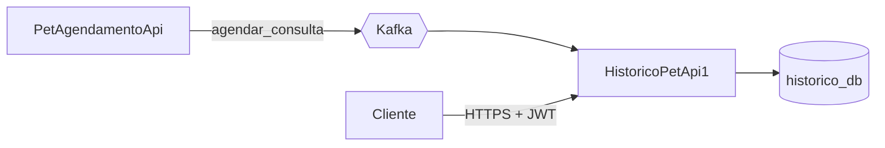

# HistoricoPetApi1 — Histórico de consultas

API que mantém o histórico das consultas veterinárias. Faz parte de um sistema de **3 microsserviços** que conversam por eventos no **Kafka**.

| Serviço | Responsabilidade |
|---|---|
| [PetServices](https://github.com/carolinebrunheti/PetServices) | Login (emite o JWT), cadastros e eventos de cadastro |
| [PetAgendamentoApi](https://github.com/carolinebrunheti/PetAgendamentoApi) | Agendamento de consultas |
| **HistoricoPetApi1** (este) | Histórico de consultas |
| [PetServicesK8s](https://github.com/carolinebrunheti/PetServicesK8s) | Manifests Kubernetes, CI/CD e testes de carga (k6) |

## Arquitetura



O serviço **só consome** eventos: cada consulta criada, remarcada ou cancelada no Agendamento chega pelo tópico `agendar_consulta` e vira (ou atualiza) um registro no histórico, já com os nomes do tutor, do pet e do veterinário. Assim a leitura do histórico não depende de nenhum outro serviço estar no ar. O JWT emitido pelo PetServices é validado localmente.

## Tecnologias

Java 17 · Spring Boot 4 · Spring Security (OAuth2 Resource Server, JWT) · Spring Data JPA · PostgreSQL 17 · Flyway · Apache Kafka 4 · JUnit 5 · Mockito · Testcontainers · Docker · GitHub Actions

## Endpoints

| Rota | Método | Quem pode |
|---|---|---|
| `/historico` | GET | Admin, atendente, veterinário |
| `/historico/{consultaId}` | GET | Admin, atendente, veterinário |
| `/actuator/health` | GET | Público (usado pelo Kubernetes) |

O histórico tem dados de todos os tutores, por isso só a equipe da clínica acessa. A listagem é paginada e começa pelas mais recentes (`?page=0&size=10&sort=diaHora,desc`, no máximo 50).

## Decisões de projeto

- **Dead Letter Topic (DLT).** Uma mensagem que não dá para processar é tentada mais 3 vezes (2 s entre elas) e depois vai para `agendar_consulta-dlt` com o conteúdo original e um log de erro, sem travar as mensagens seguintes. JSON inválido vai direto para a DLT.
- **Idempotência e ordem.** O Kafka entrega "pelo menos uma vez". O consumidor só aplica um evento se ele for **mais novo** que o último gravado para aquela consulta. Um teste de integração mostrou que, sem isso, um evento de criação reentregue depois do cancelamento fazia a consulta voltar para "agendada".
- **Recuperação de atraso.** Num teste em que o serviço ficou parado ~1 min durante a carga, ao voltar ele processou as ~565 mensagens acumuladas em 2 s, sem perder nenhuma.
- **Falha rápida.** Com o Postgres fora, responde **503 com `Retry-After`** em ~3 s.

## Testes

**37 testes**, rodando no GitHub Actions a cada push e pull request:

- **Unitários e de controller** (Mockito, MockMvc).
- **Integração com Testcontainers** (Postgres e Kafka reais): evento publicado no Kafka vira registro no banco e aparece na API com um JWT real; cancelamento atualiza a mesma consulta.
- **Mensagens problemáticas**: JSON inválido e erro ao gravar vão para a DLT; evento repetido não duplica; evento antigo não desfaz o cancelamento.
- **Segurança**: só a equipe da clínica lê; tutor, token expirado, sem token ou sem papel são recusados.

```bash
./mvnw test        # precisa do Docker rodando (Testcontainers)
```

## Como rodar localmente

Pré-requisitos: Java 17, Docker e a infraestrutura do [PetServices](https://github.com/carolinebrunheti/PetServices) rodando (`docker compose up -d` lá sobe o Postgres e o Kafka).

```bash
# 1. criar o banco deste serviço no Postgres do PetServices (uma vez)
docker exec -it petservices-db psql -U postgres -c "CREATE DATABASE historico_db"

# 2. variáveis de ambiente: o mesmo DB_PASSWORD e JWT_SECRET do PetServices
cp .env.example .env

# 3. a API
./mvnw spring-boot:run
```

A API sobe em `http://localhost:8084`. Com o Agendamento rodando, cada consulta agendada aparece aqui em instantes. Use um token de admin, atendente ou veterinário obtido no login do PetServices.
